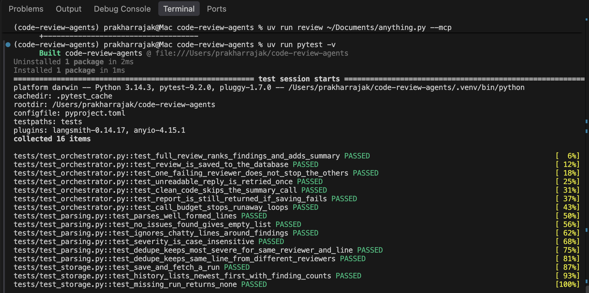
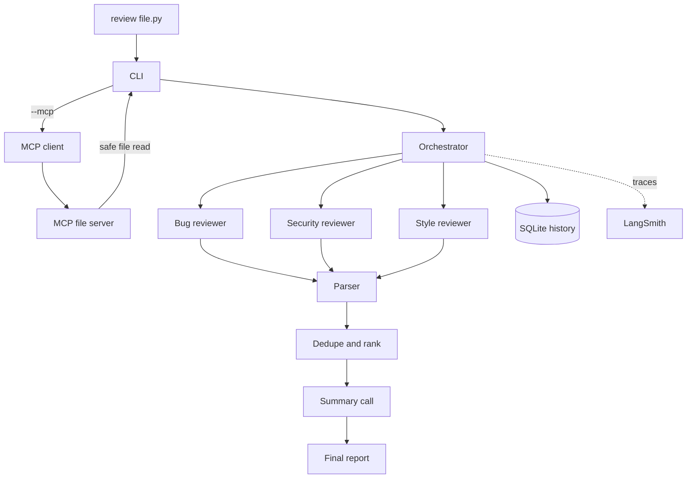

# Code Review Agents

A team of AI agents that reviews source code. Three specialist reviewers
(bugs, security, style) work independently, and an orchestrator parses,
de-duplicates, ranks, and summarizes their findings into a single report.




## Why this exists

Asking a single prompt to "review my code" returns a blurry mix of bugs, style
nits, and security notes. Splitting the job into focused agents gives cleaner
results, and orchestrating them is where the real engineering is: parsing
model output, handling failures, staying inside rate limits, storing results,
and being able to explain why the system produced what it did.

This project is built to run on **free models**, which makes those problems
unavoidable: replies are inconsistent, and request limits are tight.

## How it works



Each review makes **four model calls**: one per reviewer, plus one for the
summary.

**Design principle: the agents decide, plain code remembers.** Models are used
only where judgment is needed. Parsing, ranking, storage, and file access are
ordinary, testable code. That keeps the system cheap, fast, and predictable.

## Features

- Three specialist reviewer agents that share one strict output format
- An orchestrator that parses, de-duplicates, ranks by severity, and adds a
  short model-written summary
- Reliability: retries with backoff, a retry when a reply can't be parsed, a
  hard cap on model calls, and graceful degradation if one reviewer fails
- File access through a small MCP server that only reads inside the project
  folder and refuses files over 100 KB
- Review history in SQLite: `review --history` and `review --show ID`, with
  no model calls needed to reopen a past review
- Two layers of observability: local logs and LangSmith traces
- An offline test suite with a mock model, so tests are free and deterministic
- CI on every push (GitHub Actions)

**Tech stack:** Python 3.14, uv, OpenRouter (OpenAI-compatible API), MCP
(Python SDK), SQLite, LangSmith, pytest, GitHub Actions.

## Observability

The project has two separate layers of observability, because they answer
different questions.

| | Local logs (Python `logging`) | LangSmith traces |
|---|---|---|
| **Answers** | "Is something going wrong right now?" | "Why did the system produce this result?" |
| **Shows** | Retries, rate-limit waits, unreadable replies, failed reviewers, raw model replies in debug mode | The full nested run: every agent, each prompt and reply, the parser's output, tokens, and latency |
| **Needs** | Nothing. Works offline | A LangSmith account and network access |
| **Data leaves my machine?** | No | Yes (the code under review and the prompts) |
| **Used in** | Terminal, tests, CI | Debugging and analysis after a run |

**Why both:** logs are the always-on, zero-setup layer. They work in the
terminal and in CI, and nothing is sent to a third party. LangSmith is the
optional deep-inspection layer for when I need to see exactly how one result
was produced. Tracing is controlled by `LANGSMITH_TRACING`, so it can be
switched off completely (the test suite does this) without changing any code.

Each run appears in LangSmith as one nested trace: `code_review_run` contains
`review_code`, which contains one `run_reviewer` per agent (each with its model
call and a `parse_findings` step), followed by `build_report` and its
summary call.


Separately, every review is stored in SQLite. That is the product's record of
past results, not a debugging tool.

## Quick start

Requires Python 3.14+ and [uv](https://docs.astral.sh/uv/).

```bash
git clone https://github.com/Prakhar021-hub/code-review-agents
cd code-review-agents
uv sync
cp .env.example .env     # then add your OpenRouter key and a model name
uv run review examples/sample_code.py
```

Other commands:

```bash
uv run review examples/sample_code.py --mcp   # read the file through MCP
uv run review examples/sample_code.py -v      # show debug logs
uv run review --history                       # list past reviews
uv run review --show 1                        # reopen one, no model call
uv run pytest                                 # run tests, no API key needed
```

Works with free [OpenRouter](https://openrouter.ai) models. Free tiers are
limited to roughly 50 requests per day without purchased credits (check
OpenRouter's current limits), so the tool has a built-in call budget.

## Example output

Running `review examples/sample_code.py`, a small file that contains a crash,
a SQL injection, plaintext password storage, and missing docstrings:

```
This code has critical security and stability issues that must be addressed
immediately: it is vulnerable to SQL injection, stores passwords in
plaintext, and crashes on empty input. Prioritize fixing the SQL injection
and password storage vulnerabilities first, followed by the ZeroDivisionError
guard and the database connection leak. Once those are resolved, add the
missing docstrings and improve variable naming for maintainability.

[HIGH] line 7 (bug_reviewer): ZeroDivisionError when numbers is empty. Fix: add guard `if not numbers: return 0` or raise ValueError.
[HIGH] line 11 (security_reviewer): SQL injection via string concatenation of username into query. Fix: Use parameterized queries with placeholders.
[HIGH] line 16 (security_reviewer): Storing passwords in plaintext in a file. Fix: Hash passwords with a strong salted hash (e.g., bcrypt) before writing.
[MEDIUM] line 10 (bug_reviewer): SQLite connection never closed, leaking file handles. Fix: call conn.close() in a finally block.
[MEDIUM] line 3 (style_reviewer): missing docstring for public function. Fix: add docstring explaining purpose, args, and return value.
[LOW] line 5 (style_reviewer): unclear variable name 'n'. Fix: rename to 'num' or 'number'.
...
```

## Configuration

| Variable | Purpose |
|---|---|
| `OPENROUTER_API_KEY` | One key for any model on OpenRouter |
| `MODEL` | Which model to use (free models work) |
| `LANGSMITH_TRACING`, `LANGSMITH_API_KEY`, `LANGSMITH_PROJECT` | Optional tracing |
| `LOG_LEVEL` | Optional. Use `DEBUG` to see raw model replies |
| `REVIEW_DB` | Optional path for the history database (default `reviews.db`) |

## Project layout

```
src/code_review_agents/
  agents/            reviewer definitions (a name and a prompt each)
  orchestrator.py    run reviewers, merge, rank, summarize, save
  parsing.py         turn model text into structured findings
  storage.py         SQLite history
  mcp_server.py      safe file-reading tool
  mcp_client.py      client used by the CLI
  llm.py             the only place that calls the model
  cli.py             the `review` command
examples/            sample code with known problems
tests/               pytest suite with a mock model
```

## Decisions and lessons

Observations from running the tool repeatedly on the same sample file with a
free model, using LangSmith traces to inspect each run.

| Observation | Detail |
|---|---|
| Latency | Six successful runs took between 19 and 62 seconds (median about 38 s), because the reviewers run one after another |
| Cost per run | Roughly 2,200 to 3,400 tokens and four model calls |
| Output variance | The summary wording differed on every run, even at `temperature=0`; docstring findings were rated LOW in one run and MEDIUM in another |
| A missing finding | In one early run the plaintext-password issue was not reported. Later runs on identical input did report it |
| Overlapping reports | The style reviewer flagged the SQL query on line 11 (already reported as a security issue) and the unclosed connection on line 10 (already reported as a bug) |
| Wrong advice | The bug reviewer repeatedly suggested `with sqlite3.connect(...)` to close a connection, which only manages transactions and does not close it |

What I took from this:

- **Free models vary between runs.** Inspecting traces showed the parser
  producing correct structured findings, and the issue reappeared in later
  runs, which points to model variance and not a code bug. This is why the
  project has retries, a call budget, and strict output parsing.
- **Instructions are followed loosely.** Telling an agent to stay in its lane
  helps but does not guarantee it. The orchestrator therefore does not trust
  any single reviewer's output.
- **Findings are suggestions, not facts.** The `sqlite3` advice above is a
  confident, plausible, and wrong recommendation. A verification step would
  address this (see next steps).
- **A reviewer can fail without breaking the review.** If one agent errors,
  the others still run and the failure is logged.
- **File access is a separate service with its own safety rules.** The MCP
  server resolves paths and rejects anything outside the project folder.

## Testing

```bash
uv run pytest
```

16 tests pass in under a second. The suite replaces the model with a fake one,
so it makes no API calls, needs no keys, and disables LangSmith tracing. It
covers:

- Parsing: well-formed lines, chatty replies, "No issues found", case handling
- De-duplication: same reviewer and line versus different reviewers
- Storage: save, fetch, history order, finding counts, missing runs
- Orchestration: ranking, summary, one reviewer failing, retry on an
  unreadable reply, skipping the summary for clean code, saving failures, and
  the call budget

Tests run automatically on every push through GitHub Actions.

## Security considerations

- **No secrets in the repo.** API keys live in `.env`, which is git-ignored;
  `.env.example` contains placeholders only.
- **MCP file server is sandboxed.** Paths are resolved to their real location
  and rejected if they fall outside the working folder, which blocks
  `../` path traversal. Files over 100 KB are refused.
- **Parameterized SQL.** The history database never builds queries by joining
  strings, and every save is all-or-nothing.
- **Tracing sends code to a third party.** With `LANGSMITH_TRACING=true`, the
  code under review and the prompts are sent to LangSmith. Leave it off for
  private code. The same applies to any free model provider.

## Limitations and next steps

- **Overlaps are not merged across reviewers.** De-duplication only merges
  repeats from the same reviewer, so the same issue reported by two agents
  appears twice.
- **Latency.** Reviewers run sequentially; running them in parallel would cut
  a review from about 38 seconds toward the time of the slowest single call.
- **No verification step.** A fourth "checker" agent could re-examine each
  finding and drop wrong ones, such as the `sqlite3` advice above.
- **No quantified accuracy.** An evaluation script that runs a file with known
  issues many times and reports how often each issue is caught would turn the
  variance observed above into a measured detection rate.
- **Single files only.** Reviewing whole repositories would need chunking and
  a way to handle cross-file issues.

## License

MIT